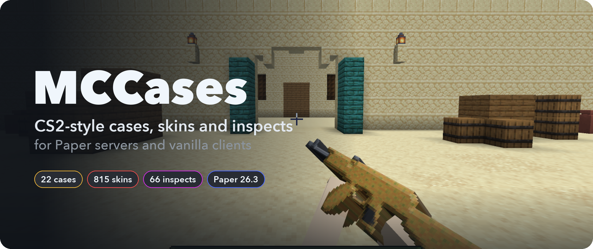
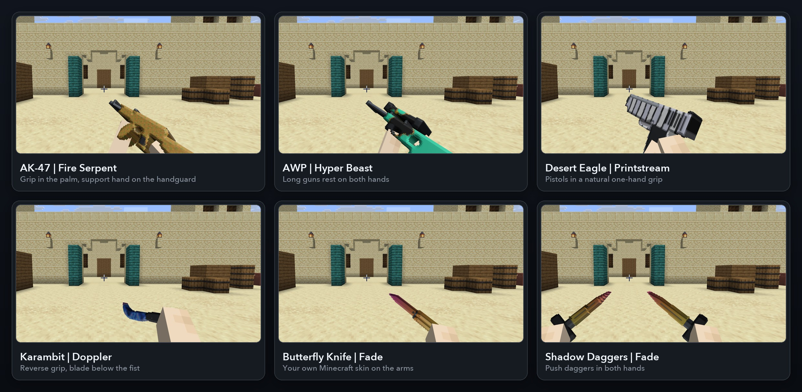
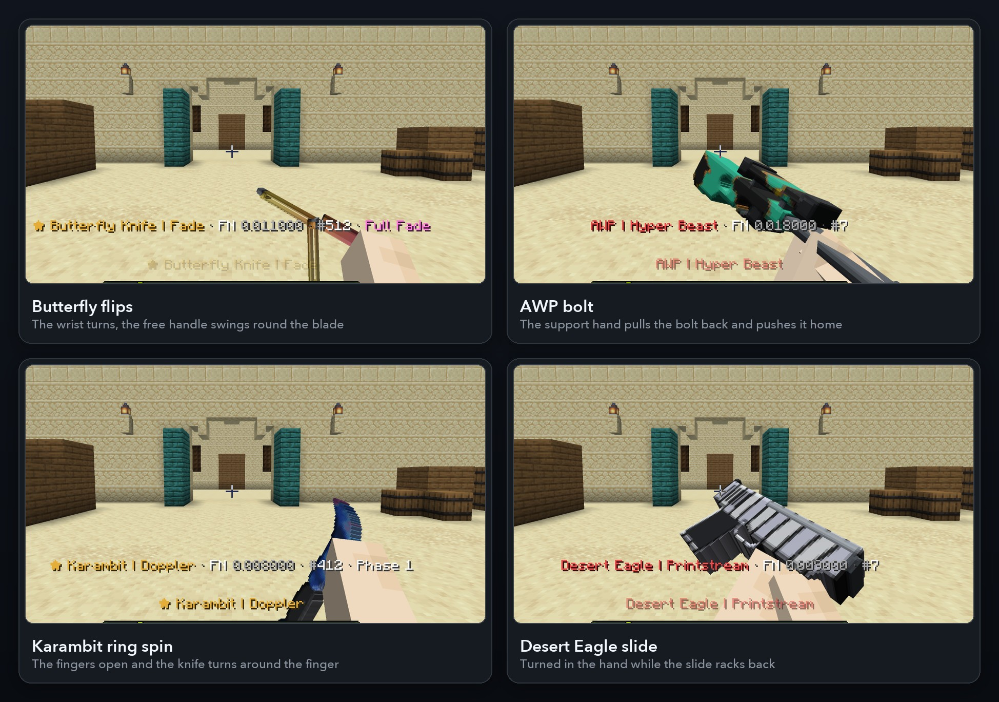
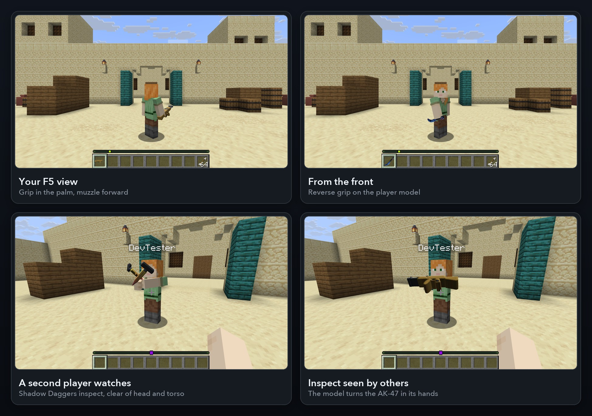
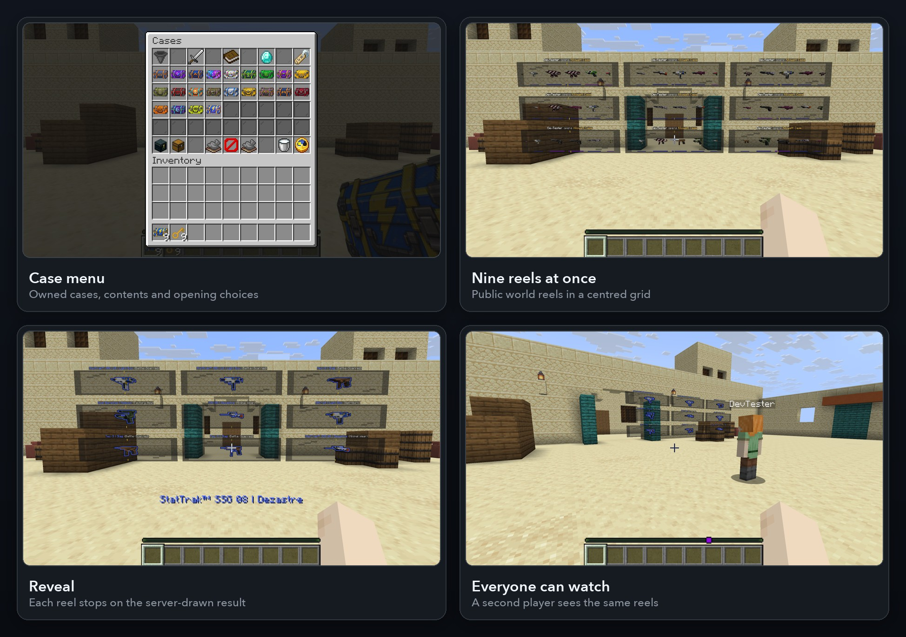
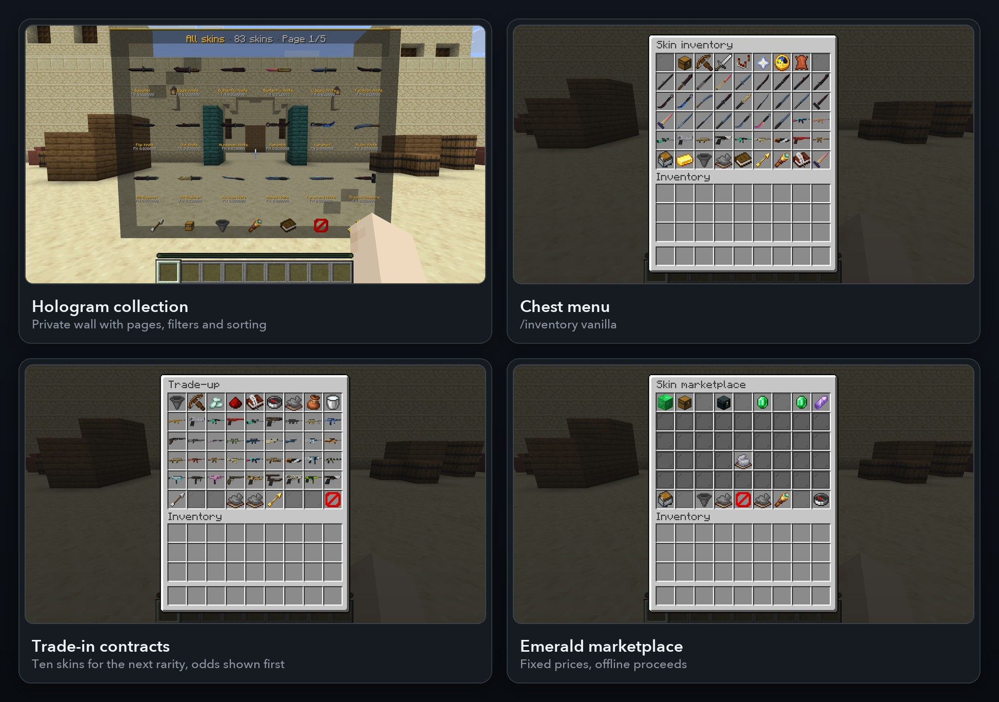
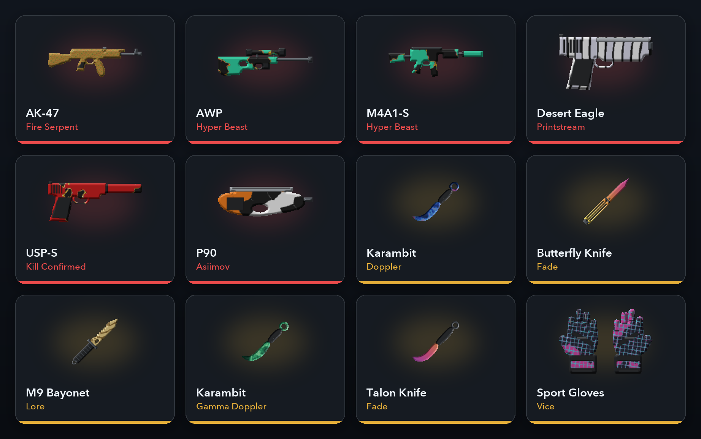
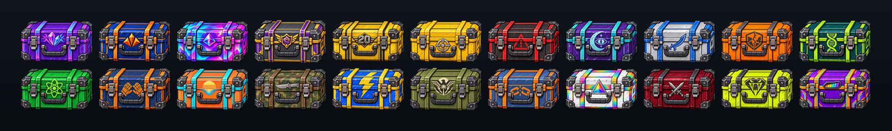

<p align="center">
  
</p>

<p align="center">
  <a href="https://github.com/Plattnericus/CS2CasesPlugin/releases/latest"></a>
  
  
  
  <a href="LICENSE"></a>
  
</p>

<p align="center">
  <a href="https://github.com/Plattnericus/CS2CasesPlugin/releases/latest"><strong>Download</strong></a> ·
  <a href="#quick-start">Quick start</a> ·
  <a href="#showcase">Showcase</a> ·
  <a href="#gameplay">Gameplay</a> ·
  <a href="#commands-and-permissions">Commands</a> ·
  <a href="#configuration">Configuration</a> ·
  <a href="#resource-pack">Resource pack</a> ·
  <a href="#releases">Releases</a> ·
  <a href="#license">License</a>
</p>

MCCases brings Counter-Strike 2 style cases, skins and inspects to a plain **Paper** server. Players
open cases in public reels, collect skins with real float, pattern and StatTrak values, trade them,
sell them for Emeralds and inspect them in their own hands. Everything runs on the server; players
join with a normal Minecraft client and the matching resource pack. No mods, no client plugins.

> [!IMPORTANT]
> **NOT AN OFFICIAL MINECRAFT PRODUCT. NOT APPROVED BY OR ASSOCIATED WITH MOJANG OR MICROSOFT.**
> MCCases is an independent project and is not affiliated with or endorsed by Valve.
> See [legal information](#legal-information).

<div align="center">

| **22** | **815** | **63** | **66** | **9** | **45** |
| :---: | :---: | :---: | :---: | :---: | :---: |
| cases | skins | weapon, knife and glove models | natural inspect animations | parallel openings per player | languages |

</div>

## Showcase

Every picture below is an unedited frame from a vanilla Minecraft 26.3 client on a Paper 26.3 server
running this build with the generated resource pack.

### Your arms, your weapon

Your own Minecraft skin arms (wide or slim) hold every knife and gun in first person, with a 3D
weapon rig and a subtle metal sheen. The grip sits in the palm and the support hand on the handguard;
Karambit and Talon use a reverse grip and Shadow Daggers are held in both hands. Left-handed players
get a mirrored view.



### Natural inspects

Press **F** and you look at your weapon the way you would in real life: the wrist turns it to show
one side and then the other, the elbow and shoulder follow and the second hand lets go and grabs
again. Slides rack, bolts pull and pumps cycle. Every knife has its own inspects: the Butterfly Knife
really flips open and shut (the blade and the bite handle swing round the safe handle on their own
pins), the Karambit and Talon spin on the index finger in the ring, the Flip, Navaja, Stiletto,
Falchion and Ursus flick their blades shut and open, heavy blades chop and the rest are tossed end
over end, twirled at the guard or rolled like a coin. Knives sit in the hand edge down, spine up.
While the hand holds the weapon, the wrist always stays in its real range; whole turns only happen
in real tricks where the fingers let go. 102 animations; every playback varies a little and never
repeats twice in a row.



### Seen by everyone

Other players, and your own F5 view, see the player model raise both arms and turn the weapon in its
real hand, always clear of head and torso. The pack's shaders pick the right scene for each camera,
so F5 just works.



### Case openings

Pick a case in `/cases` and open up to nine at once. Each opening runs as a public reel in the world
that everyone nearby can watch. The server draws every result before the animation starts.



### Collection, trading and trade-ups

Your collection appears as a private hologram wall or a chest menu. Trade directly with both players
confirming, sell on an Emerald marketplace and turn ten skins into the next rarity with trade-in
contracts that show their odds first.



### The catalog

22 cases with 815 skins across 35 weapons, 20 knives and 5 glove types, including Doppler phases,
Fade percentages, Blue Gem tiers and Fire & Ice. All skin artwork is rendered by the plugin from
the catalog.





## Features

| | |
| --- | --- |
| **Case openings** | 22 cases, up to nine public reels at once per player; 1–1000 cases per request, the rest wait in line. |
| **Real skin values** | Float, exterior, pattern, StatTrak, origin and date; Doppler phases, Fade percentage, Blue Gem tiers and Fire & Ice. |
| **View model** | Your skin arms hold every knife and gun; drawing a bow aims, charging a crossbow reloads, a loaded crossbow stays ready. |
| **Inspects** | 102 natural held-pose animations with moving parts (63 of them for the 20 knives, each knife its own set), plus 362 articulated profile inspects for gloves, menus and servers without the pack. |
| **Trading and economy** | Direct trades confirmed by both players, an Emerald marketplace with offline proceeds and trade-in contracts. |
| **Built to last** | SQLite or MySQL/MariaDB, signed case and key items, journals that recover interrupted openings and payments. |
| **45 languages** | English for everyone by default; optional per-client translations. |

Skins are cosmetic: damage, durability and enchantments of the real item stay intact.

## Quick start

1. Run a **Paper 26.3 server with Java 25** and accept the Minecraft EULA yourself.
2. Download `MCCases-<version>.jar` from the [latest release](https://github.com/Plattnericus/CS2CasesPlugin/releases/latest)
   (or build it, see [Building from source](#building-from-source)) and put it into `plugins/`.
   Install only one MCCases JAR.
3. Start the server. Default files appear in `plugins/MCCases/`.
4. Give your players the matching resource pack: the built-in distribution, or the ZIP from the same
   release (also in [`resourcepack/`](resourcepack)). Then set `resource-pack.enabled: true`.
5. As an operator, check `/csadmin info` and place a dealer with `/csadmin shop spawn`.

Hand a player their first cases:

```text
/csadmin givecase PlayerName kilowatt_case 9
/csadmin givekey PlayerName case_key 9
```

The player opens `/cases`, picks the case and chooses **Open 9 cases together**, or types
`/cases open kilowatt_case 9`. Every opening consumes one signed case and its matching key.

> [!NOTE]
> No other plugins are required. The build targets Paper 26.3 build 159 (a beta at the time of
> writing); other versions need their own testing.

## Gameplay

### Collection and equipment

`/inventory` or `/skins` opens your collection as a private hologram wall; `/inventory vanilla`
opens it as a chest menu and `/knife` shows your knives. There is no shortcut item in the
inventory by default.

| In the collection | Action |
| --- | --- |
| Look at a skin | Name and values in the action bar |
| Right-click | Inspect menu (also delete your own skin after confirmation) |
| Left-click a knife | Equip or unequip it |
| Left-click / sneak + left-click a weapon | Equip on the bow / on the crossbow |
| Sneak + right-click | Toggle favorite |
| Buttons below the wall | Page, category, sort order, filters or list view |
| Walk ten blocks away | The collection closes |

A skin occupies one slot: **knife** (shown on swords), **bow** or **crossbow**. Collections are
virtual, so dropping the sword does not hand over the skin. Other players can view a collection but
cannot change it.

### Holding and using weapons

With the pack, the held skin is shown in your own skin arms. Drawing a bow aims the gun, charging a
crossbow reloads it and a loaded crossbow stays ready; the weapon's real behavior is unchanged.
Left-handed players get a mirrored view. In third person the grip sits in the palm, blade or muzzle
forward.

### Inspecting

| Input | Action |
| --- | --- |
| **F** (Swap Hands) | Inspect the held skin |
| **Sneak + right-click** | Inspect; it plays once you stand up |
| **Sneak + F** | Swap hands normally |
| `/inspect` | Inspect the held skin, or the equipped knife |
| `/inspect hand` · `/inspect view` | Body-hand scene only · back to the normal view |

Inspects start and end in your hold, so the weapon never jumps, and the item keeps its hotbar slot.
The scene stays locked to your view while walking, crouching and standing up; bows and crossbows
do not fire while they are inspected. Gloves, inspects from menus and servers without the pack use
the 362 articulated profile inspects.

### Case openings

| | |
| --- | --- |
| Open | `/cases`, pick a case: **Open 9 cases together** or 18, 25, 50, 90, 100; `/cases open <Case> <1–1000>` |
| Watch | Up to nine world reels run at once in a centered grid, the rest wait; everyone nearby can watch |
| Follow | `/openings` shows running and waiting openings and the last 20 results; `/cases cancel` drops waiting ones |
| Safety | Results are drawn and saved before the animation; disconnects, death and restarts never lose a drop |

### Trading

`/trade PlayerName` sends a request (or `/trade` to pick a player). The trade menu shows both offers
side by side; **Open full collection** lets you search, filter and sort your skins and add up to
twelve. Both players must accept the exact same offer: every change clears both confirmations and
starts a two-second review. Closing the menu, `/trade cancel`, leaving or five idle minutes cancel
the trade. Offered skins cannot be sold, equipped or deleted meanwhile.

### Marketplace

`/market` sells skins for real **Emerald items** from your inventory (storage slots and, by default,
the offhand). Browse, search and filter listings, sell with **Sell a skin** or
`/market sell <Skin-ID> <Price>`, and manage your own listings with `/market own`. Sellers are paid
even when offline and collect with `/market claims`; nothing is dropped on the ground, partial
payouts wait until there is room. Defaults: 20 listings per player, prices from 1 to 1,000,000
Emeralds.

### Trade-in contracts

`/tradein` (or `/tradeup`) turns ten weapons of the same rarity and StatTrak type into one of the
next tier, or five Coverts into a rare special gold item. **Possible rewards** shows every outcome
with its exact chance before you confirm; the average input float carries over. Gold results are
announced to the server.

### Dealer

A villager or mannequin (`/csadmin shop spawn`) sells cases and keys for diamonds; prices are in
`shop.yml`.

## Commands and permissions

`<Argument>` is required, `[Argument]` optional. Case, key and skin IDs have tab completion.

| Player command | Permission | Purpose |
| --- | --- | --- |
| `/skins [Player]`, `/inventory`, `/inventory vanilla` | `mccases.use` | Your collection, or a known player's |
| `/knife [Player]` | `mccases.use` | Knife collection |
| `/cases`, `/cases open <Case> <Amount>`, `/cases cancel` | `mccases.use` | Cases and openings |
| `/openings` | `mccases.use` | Active openings and recent rewards |
| `/inspect [hand\|view]` | `mccases.inspect` | Inspect and choose the view |
| `/trade [Player]`, `/trade accept\|decline\|cancel` | `mccases.trade` | Direct trading |
| `/market`, `/market own`, `/market sell <Skin-ID> <Price>`, `/market search <Name>` | `mccases.market` | Marketplace |
| `/market balance`, `/market claims`, `/market recover` | `mccases.market` | Emeralds, proceeds and recovery |
| `/tradein`, `/tradeup` | `mccases.tradein` | Trade-in contracts |

<details>
<summary><strong>Operator commands</strong> (<code>/csadmin</code>, alias <code>/mccases</code>, permission <code>mccases.admin</code>)</summary>

| Command | Purpose |
| --- | --- |
| `/csadmin info` | Version, catalog size and pack address |
| `/csadmin givecase <Player> <Case> [Amount] [test]` | Give signed cases (1–64); `test` marks the results as tests |
| `/csadmin givekey <Player> <Key> [Amount] [test]` | Give signed keys |
| `/csadmin giveskin <Player> <Skin> [Float] [Pattern] [StatTrak]` | Add a skin to a collection |
| `/csadmin list <Player>` · `/csadmin history <Player>` | Skin instances with short IDs · last 15 openings |
| `/csadmin manage <Player>` | Manage a collection in a menu, also of known offline players |
| `/csadmin equip <Player> <ID>` · `/csadmin equipslot <Player> <ID> <knife\|bow\|crossbow>` | Equip a skin |
| `/csadmin setfloat` · `setpattern` · `setstattrak <Player> <ID> <Value>` | Edit skin values |
| `/csadmin removeskin <Player> <ID>` | Remove a skin |
| `/csadmin testcase <Case> [keep]` | Test opening without consuming items |
| `/csadmin odds <Case>` | Real drop chances of the loaded catalog |
| `/csadmin preview <Skin> [Pattern] [Float]` · `pattern <Skin> <Pattern>` | Preview and analyze a pattern |
| `/csadmin browser <Skin> [Pattern]` · `scan <Skin> [Metric] [Count]` | Pattern browser · rank seeds by a metric |
| `/csadmin shop spawn [villager\|mannequin]` · `/csadmin shop remove` | Dealers |
| `/csadmin exportpack` · `/csadmin reload` | Rebuild the pack · reload configuration and catalog |

`<ID>` is a skin instance from `/csadmin list` (a UUID or an unambiguous prefix), not a catalog ID.

```text
/csadmin giveskin PlayerName butterfly_doppler 0.02 10 false
/csadmin giveskin PlayerName ak47_case_hardened 0.03 661 true
/csadmin equipslot PlayerName <ID-from-the-list> bow
/csadmin odds kilowatt_case
/csadmin scan ak47_case_hardened playside.blue 10
```

</details>

| Permission | Default | Access |
| --- | --- | --- |
| `mccases.use`, `mccases.inspect`, `mccases.view`, `mccases.shop` | Everyone | Collection, cases, inspects, other collections, dealer |
| `mccases.trade`, `mccases.market`, `mccases.tradein` | Everyone | Trading, marketplace, trade-in |
| `mccases.admin` | Operators | All admin commands and management menus |

## Configuration

All files live in `plugins/MCCases/`. Missing defaults are added on startup; existing settings are kept.

| Setting (`config.yml`) | Default | Purpose |
| --- | --- | --- |
| `language` · `client-language` | `en` · `false` | Server language; `true` follows each player's Minecraft language |
| `storage.type` | `sqlite` | `sqlite`, `mysql` or `mariadb` (credentials under `storage.mysql`) |
| `skin-inventory.display` · `opening.display` | `world` | Hologram wall and world reels, or `gui` |
| `opening.max-active-per-player` | `9` | Simultaneous openings per player (at most nine) |
| `opening.duration-ticks` · `opening.easing` | `120` · `cinematic` | Reel duration and deceleration |
| `opening.broadcast-rare` · `trade-in.broadcast-gold` | `true` | Announce rare drops and gold contracts |
| `inspect.held-pose` | `true` | Inspect held skins in your own arms (requires the pack) |
| `inspect.swap-hand-key` · `inspect.sneak-right-click` | `true` | Inspect inputs |
| `knives.bow-skins` · `knives.crossbow-skins` | `true` | Allow weapon skins on bows and crossbows |
| `stattrak.count-mobs` | `false` | Count mob kills as well as player kills |
| `resource-pack.enabled` | `false` | Use the pack's models (`true` once every player has the pack) |

<details>
<summary><strong>Files, languages and storage</strong></summary>

```text
plugins/MCCases/
├── config.yml            Server, display, opening, inspect and pack options
├── shop.yml              Dealer currency (default DIAMOND) and prices
├── market.yml            Emerald marketplace, claims and trade limits
├── inspect.yml           Held-pose inspects, profile models and positions
├── inspect-profiles.yml  The 362 articulated profile inspects
├── sounds.yml            Sound cues
├── messages_*.yml        45 translations (MiniMessage)
├── catalog/              Cases, skins, weapons, rarities, keys, patterns and styles
├── textures/             Weapon layers, patterns, wear and overlays
├── resourcepack/         The bundled or exported pack
├── data.db               SQLite database (default)
└── secret.key            Signing key for cases and keys; back it up
```

**Languages.** English is used for everyone by default. With `client-language: true`, menus, chat,
item names and lore follow each client's language (exact locale, then base language, then the server
language). Add or edit `messages_<locale>.yml` and run `/csadmin reload`. Bundled: af, ar, be, bg, ca,
cy, da, de, en, eo, es, fil, fr, fy, ga, gd, gl, he, hi, hr, id, is, it, ja, ko, lb, mi, ms, mt, nb,
nl, nn, pl, pt_br, pt_pt, ro, ru, sl, sv, tr, tt, uk, yo, zh_cn, zh_tw.

**Storage.** SQLite uses `data.db`; MySQL or MariaDB are configured under `storage.mysql` (table prefix
`pc_`). Database work runs off the main thread. Every opening is journaled in the player data and saved
together with the skin in one transaction, so interrupted results are recovered on the next login.
Cases and keys carry signed identifiers; a renamed item is not a valid case. Back up the database,
player data and `secret.key` together.

</details>

### Drops and skin values

| Rarity | Mil-Spec | Restricted | Classified | Covert | Rare Special (gold) |
| --- | ---: | ---: | ---: | ---: | ---: |
| Default weight | 79.923 | 15.985 | 3.197 | 0.639 | 0.256 |

| Exterior | Factory New | Minimal Wear | Field-Tested | Well-Worn | Battle-Scarred |
| --- | --- | --- | --- | --- | --- |
| Float | 0.00–0.07 | 0.07–0.15 | 0.15–0.38 | 0.38–0.45 | 0.45–1.00 |

Eligible items have a **10 %** StatTrak chance and there is no pity system. The real distribution
depends on a case's contents; `/csadmin odds <Case>` shows it. StatTrak counts player kills with the
skin in the main hand.

<details>
<summary><strong>Included cases</strong></summary>

`csgo_weapon_case`, `operation_bravo_case`, `operation_breakout_case`, `huntsman_case`, `falchion_case`,
`shadow_case`, `chroma_case`, `chroma_2_case`, `cs20_case`, `chroma_3_case`, `gamma_case`,
`gamma_2_case`, `glove_case`, `spectrum_case`, `clutch_case`, `horizon_case`, `danger_zone_case`,
`prisma_case`, `fracture_case`, `snakebite_case`, `dreams_and_nightmares_case`, `kilowatt_case`.
All open with `case_key`.

</details>

<details>
<summary><strong>Adding your own case</strong></summary>

Create `catalog/cases/my_case.yml`; the file name is the case ID:

```yaml
case:
  name: "My Case"
  key: case_key
  color: "#3a8ab0"
  stattrak-chance: 0.10
  description: ["Custom Collection"]

skins:
  ak47_neon_wave:
    weapon: ak47
    rarity: covert
    name: "Neon Wave"
    style: waves
    palette: ["#0a0a2a", "#e83ab0", "#2ad0f0"]
    float: [0.0, 0.7]

rare-special:
  knives: [karambit, butterfly]
  finishes: chroma
```

Run `/csadmin reload`, check the console and use `/csadmin exportpack` to rebuild the pack. Weapon,
style, rarity, key and finish IDs must exist in the catalog. Custom pattern PNGs go into
`textures/patterns/` and are linked in `catalog/styles.yml`; weapons use square PNG layers
(`mask.png` required, plus optional `paint`, `base`, `shadow`, `highlight` and `wear`) in
`textures/weapons/<ID>/`.

</details>

## Resource pack

The pack is generated from the catalog, embedded in the JAR and written to
`plugins/MCCases/resourcepack/MCCases-ResourcePack.zip`. Every release also ships it as a separate
download, and [`resourcepack/MCCases-ResourcePack.zip`](resourcepack) in this repository is always the
current one. It contains the 128 px skin sprites, the 3D weapon rigs, the skin-arm view models and
Minecraft 26.3 shader programs: the entity shaders draw each player's own skin on the arms, the item
shaders add a subtle metal sheen and separate the first- and third-person inspect scenes. No skin is
stored in the pack.

**Built-in distribution:** the plugin serves the pack itself and offers it on join.

```yaml
resource-pack:
  enabled: true
  namespace: mccases
  distribution:
    enabled: true
    bind-address: 0.0.0.0
    port: 8165
    public-url: "http://mc.example.net:8165"   # must be reachable by players
    required: false                            # true kicks players who decline
```

**Own server pack:** copy `assets/mccases/` and `assets/minecraft/shaders/` from the ZIP into your
pack, set `resource-pack.enabled: true`, leave the built-in distribution off and re-export with
`/csadmin exportpack` after catalog changes. Shader packs that replace the same core shaders need a
manual merge.

## Updating

1. Stop the server and back up `plugins/MCCases/`, the database, world and player data and `secret.key`.
2. Replace the JAR and the resource pack together; they are a matched pair.
3. Start the server and check `/csadmin info`.

Releases are versioned by date as `vMONTH.DAY.YEAR`; the version is in the file names, `/csadmin info`
and the startup log. **10.17.2026** brings natural inspects: servers that still have the unchanged
1.3.0 inspect animations in `inspect.yml` get the new motion automatically, while edited animations
stay as they are. See the [changelog](CHANGELOG.md).

## Troubleshooting

| Symptom | Check |
| --- | --- |
| Missing textures or models | The matching pack is loaded and `resource-pack.enabled` is `true` |
| Arms look like stretched heads | Another shader pack replaces the core shaders, or the client is not on Minecraft 26.3 |
| **F** does not inspect | Hold an equipped skin; check `mccases.inspect` and `inspect.swap-hand-key` |
| F5 shows no first-person inspect | Correct: in third person the pack shows the body-hand scene |
| A skin does not fit a slot | Knives need `knife`, weapon skins `bow` or `crossbow` |
| An opening does not start | A valid case and its matching key are required; see `/cases` |
| The language does not change | Check `language`, `client-language` and the `messages_<locale>.yml` files, then `/csadmin reload` |
| The dealer does not sell a case | Check prices and `cases.exclude` in `shop.yml` |
| New content is missing | Check IDs, PNG files and the console warnings after `/csadmin reload` |

## Building from source

You need **JDK 25**; the Gradle wrapper downloads everything else.

```sh
bash gradlew build                              # plugin, resource pack and all checks
bash gradlew build -PpluginVersion=10.17.2026   # the same with an explicit version
```

The build writes `build/libs/MCCases-<version>.jar` and `build/distributions/MCCases-ResourcePack-<version>.zip`,
refreshes `resourcepack/MCCases-ResourcePack.zip` and runs every check: catalog, odds and economy
transactions, all rigs and inspect timelines, the natural wrist range, the third-person scene, the
resource pack and its installer.

## Releases

Releases are built by GitHub Actions. To publish one:

1. Open **Releases → Draft a new release** and create the tag `vMONTH.DAY.YEAR`, for example
   `v10.17.2026` (a second release on the same day: `v10.17.2026-2`).
2. Write the notes and click **Publish release**.
3. The [release workflow](.github/workflows/release.yml) builds the plugin and the resource pack with
   that version, runs every check and attaches both files to the release within a few minutes:

| File | Contents |
| --- | --- |
| `MCCases-<version>.jar` | The plugin, with the version in `plugin.yml` and the resource pack embedded |
| `MCCases-ResourcePack-<version>.zip` | The matching resource pack for your players or your server pack |

A tag that is not a date takes the release date as version. **Actions → Release → Run workflow**
builds the same files without a release and keeps them with the run.

## License

MCCases is published under the [MCCases License](LICENSE), a source-available, non-commercial license:

| You may | You must | You may not |
| --- | --- | --- |
| Use the plugin for free, also on public servers | Keep the license and the credits the plugin shows | Sell the plugin, a modified version or access to it |
| Change it and share copies or improved versions for free | Credit **"Based on MCCases by Plattnericus"** with a link, visibly on the public page of anything you publish that copies or builds on it | Sell cases, keys, skins or openings for real money |
| Study the code and learn from it | Say that you changed it | Call your version MCCases or present it as the official one |

If MCCases only inspired your project, a credit is appreciated. The license does not cover the
third-party material listed in [THIRD_PARTY_NOTICES.md](THIRD_PARTY_NOTICES.md). For other uses,
contact info@plattnericus.dev.

## Legal information

The intended operation uses **only free in-game currency**: no real-money purchases of cases, keys
or skins, no cash-out, external sales or prizes, and the real drop chances are published
(`/csadmin odds`). These rules are not legal approval for a particular country.

- [Legal information and operator details](LEGAL.md) · [Italian privacy template](PRIVACY-IT.md) ·
  [Third-party notices](THIRD_PARTY_NOTICES.md)
- Counter-Strike, CS2, CS:GO and StatTrak are trademarks of Valve; Minecraft is a trademark of
  Mojang/Microsoft. Skin artwork is rendered by the plugin; the arms show each player's own skin.

<p align="center">
  <strong>Contact:</strong> <a href="mailto:info@plattnericus.dev">info@plattnericus.dev</a> ·
  <a href="https://plattnericus.dev">plattnericus.dev</a> ·
  <a href="https://github.com/Plattnericus/CS2CasesPlugin/issues">Issues</a>
</p>
