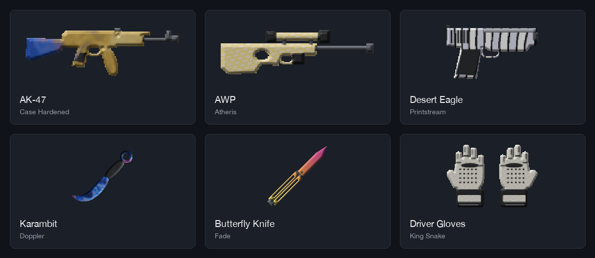
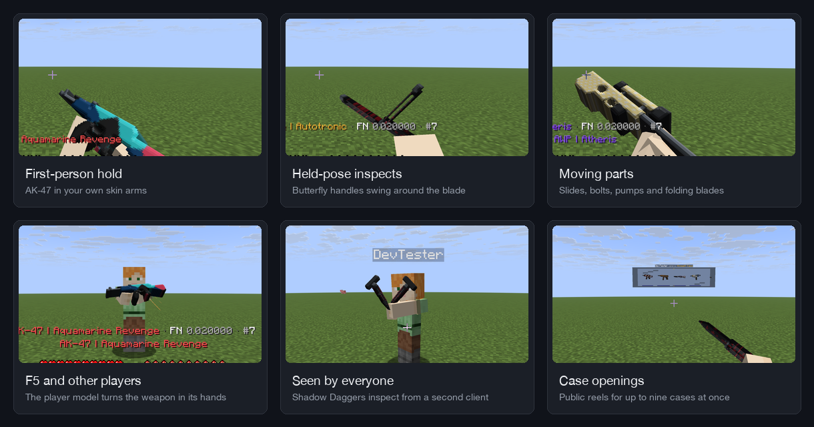

<h1 align="center">MCCases</h1>

<p align="center">
  <strong>CS2-style cases, skins and inspects for Minecraft — on a plain Paper server, with a vanilla client.</strong>
</p>

<p align="center">
  
  
  
  
  
</p>

<p align="center">
  <a href="#quick-start">Quick start</a> ·
  <a href="#gameplay">Gameplay</a> ·
  <a href="#commands-and-permissions">Commands</a> ·
  <a href="#resource-pack">Resource pack</a> ·
  <a href="#configuration">Configuration</a> ·
  <a href="#development">Development</a> ·
  <a href="docs/REFERENCE.md">Full reference</a>
</p>



MCCases is a server-side Paper plugin: players open cases in public reels, collect skins with real
float, pattern and StatTrak values, trade them, sell them for Emeralds and inspect them in their own
hands. Everything runs on the server; players only need the matching resource pack.

> **NOT AN OFFICIAL MINECRAFT PRODUCT. NOT APPROVED BY OR ASSOCIATED WITH MOJANG OR MICROSOFT.**
> MCCases is an independent project and is not affiliated with or endorsed by Valve.
> See [legal information](#legal-information).

## Highlights



| | |
| --- | --- |
| **Your arms, your weapon** | Your own Minecraft skin arms (wide or slim) hold every knife and gun in first person: grip in the palm, support hand on the handguard, reverse grip for Karambit and Talon, Shadow Daggers in both hands. |
| **Held-pose inspects** | 66 animations in eleven families. The wrist turns the 3D weapon, elbow and shoulder follow and the second hand lets go and grabs again; slides rack, bolts pull, pumps cycle, butterfly handles swing and folding blades flick. |
| **Seen by everyone** | Other players and your own F5 view see the player model turn the weapon in its hands, always clear of head and torso. |
| **Case openings** | 22 cases, up to nine public reels at once; the server draws every result before the animation starts. |
| **Real skin values** | Float, exterior, pattern, StatTrak, origin and date; Doppler phases, Fade percentage, Blue Gem tiers and Fire & Ice. |
| **Trading and economy** | Direct trades confirmed by both players, an Emerald marketplace with offline proceeds and trade-in contracts. |
| **Built to last** | SQLite or MySQL/MariaDB, signed case and key items, journals that recover interrupted openings and payments. |
| **45 languages** | English for everyone by default; optional per-client translations. |

Skins are cosmetic: damage, durability and enchantments of the real item stay intact.

## Quick start

1. Run a **Paper 26.3 server with Java 25** and accept the Minecraft EULA yourself.
2. Put the plugin JAR into `plugins/` — from the [releases page](https://github.com/Plattnericus/CS2CasesPlugin/releases)
   or built with `bash gradlew build`. Install only one MCCases JAR.
3. Start the server. Default files appear in `plugins/MCCases/`.
4. Give players the matching resource pack (built-in distribution or your own server pack, see
   [Resource pack](#resource-pack)) and set `resource-pack.enabled: true`.
5. As an operator, check `/csadmin info` and place a dealer with `/csadmin shop spawn`.

Hand a player their first cases:

```text
/csadmin givecase PlayerName kilowatt_case 9
/csadmin givekey PlayerName case_key 9
```

The player opens `/cases`, picks the case and chooses **Open 9 cases together** — or types
`/cases open kilowatt_case 9`. Every opening consumes one signed case and its matching key.

No other plugins are required. The build targets Paper 26.3 build 159 (a beta at the time of
writing); other versions need their own testing.

## Gameplay

### Collection and equipment

`/inventory` or `/skins` opens your collection as a private hologram wall; `/inventory vanilla`
opens it as a chest menu and `/knife` shows your knives.

| In the collection | Action |
| --- | --- |
| Look at a skin | Name and values in the action bar |
| Right-click | Inspect menu |
| Left-click a knife | Equip or unequip it |
| Left-click / sneak + left-click a weapon | Equip on the bow / on the crossbow |
| Sneak + right-click | Toggle favorite |
| Page buttons | Browse, filter and sort |

A skin occupies one slot — **knife** (swords), **bow** or **crossbow**. Collections are virtual:
dropping the sword does not hand over the skin.

### Holding and using weapons

With the pack, the held skin is shown in your own skin arms. Drawing a bow aims the gun, charging a
crossbow reloads it and a loaded crossbow stays ready — the weapon's real behavior is unchanged.
Left-handed players get a mirrored view. In third person the grip sits in the palm, blade or muzzle forward.

### Inspecting

| Input | Action |
| --- | --- |
| **F** (Swap Hands) | Inspect the held skin |
| **Sneak + right-click** | Inspect; it plays once you stand up |
| **Sneak + F** | Swap hands normally |
| `/inspect` | Inspect the held skin, or the equipped knife |
| `/inspect hand` · `/inspect view` | Body-hand scene only · back to the normal view |

Inspects start and end in your hold, so the weapon never jumps, and the item keeps its hotbar slot.
The scene stays locked to your view while walking, crouching and standing up; bows and crossbows
do not fire while they are inspected. Every playback varies a little and never repeats twice in a
row. The pack's shaders pick the right scene for your camera, so F5 just works.

Gloves, inspects from menus and servers without the pack use the 362 articulated profile inspects.

### Openings, trading and trade-in

| | Entry | How it works |
| --- | --- | --- |
| Case openings | `/cases`, `/openings`, `/cases cancel` | 1–1000 cases per request; up to nine reels run at once, the rest wait |
| Direct trading | `/trade PlayerName` | Both players confirm the same offer; every change resets confirmations |
| Marketplace | `/market` | Fixed prices paid in real Emerald items; offline sellers collect with `/market claims` |
| Trade-in | `/tradein`, `/tradeup` | Ten compatible skins for the next rarity, five Coverts for a gold item; odds shown before you confirm |
| Dealer | Villager or mannequin | Sells cases and keys for diamonds |

Nothing is ever dropped on the ground: rewards and proceeds wait until there is room.

## Commands and permissions

| Player command | Purpose |
| --- | --- |
| `/inventory`, `/skins [Player]`, `/inventory vanilla`, `/knife [Player]` | View collections |
| `/cases`, `/cases open <Case> <Amount>`, `/openings`, `/cases cancel` | Cases and openings |
| `/inspect [hand\|view]` | Inspect and choose the view |
| `/trade [Player]`, `/trade accept\|decline\|cancel` | Direct trading |
| `/market`, `/market own`, `/market sell <Skin-ID> <Price>`, `/market search <Name>` | Marketplace |
| `/market balance`, `/market claims`, `/market recover` | Emeralds, proceeds and recovery |
| `/tradein`, `/tradeup` | Trade-in contracts |

<details>
<summary><strong>Operator commands</strong> (<code>/csadmin</code>, alias <code>/mccases</code>)</summary>

| Command | Purpose |
| --- | --- |
| `/csadmin info` | Version, catalog and pack status |
| `/csadmin givecase <Player> <Case> [Amount] [test]` | Give signed cases |
| `/csadmin givekey <Player> <Key> [Amount] [test]` | Give signed keys |
| `/csadmin giveskin <Player> <Skin> [Float] [Pattern] [StatTrak]` | Add a skin to a collection |
| `/csadmin list <Player>` · `/csadmin history <Player>` | Skin instances · last openings |
| `/csadmin manage <Player>` | Manage a collection, also of known offline players |
| `/csadmin equip <Player> <ID>` · `/csadmin equipslot <Player> <ID> <Slot>` | Equip a skin |
| `/csadmin setfloat` · `setpattern` · `setstattrak <Player> <ID> <Value>` | Edit skin values |
| `/csadmin removeskin <Player> <ID>` | Remove a skin |
| `/csadmin testcase <Case> [keep]` | Test opening without consuming items |
| `/csadmin odds <Case>` | Real drop chances of the loaded catalog |
| `/csadmin preview` · `pattern` · `browser` · `scan` | Pattern preview and analysis tools |
| `/csadmin shop spawn [villager\|mannequin]` · `/csadmin shop remove` | Dealers |
| `/csadmin exportpack` · `/csadmin reload` | Rebuild the pack · reload configuration and catalog |

</details>

| Permission | Default | Access |
| --- | --- | --- |
| `mccases.use`, `mccases.inspect`, `mccases.view`, `mccases.shop` | Everyone | Collection, cases, inspects, other collections, dealer |
| `mccases.trade`, `mccases.market`, `mccases.tradein` | Everyone | Trading, marketplace, trade-in |
| `mccases.admin` | Operators | All admin commands |

Every command and argument is documented in the [full reference](docs/REFERENCE.md#commands).

## Resource pack

The pack is generated from the active catalog, embedded in the JAR and written to
`plugins/MCCases/resourcepack/MCCases-ResourcePack.zip`. It contains the 128 px skin sprites, the
3D weapon rigs, the skin-arm view models and Minecraft 26.3 shader programs: the entity shaders draw
each player's own skin on the arms, the item shaders add a subtle metal sheen and separate the first-
and third-person inspect scenes. No skin is stored in the pack.

**Built-in distribution** — edit the `resource-pack` section of `config.yml`:

```yaml
resource-pack:
  enabled: false        # true once every player has the pack
  namespace: mccases
  distribution:
    enabled: true
    bind-address: 0.0.0.0
    port: 8165
    public-url: "http://mc.example.net:8165"
    required: false
```

**Own server pack** — copy `assets/mccases/` and `assets/minecraft/shaders/` from the ZIP into your
pack, set `resource-pack.enabled: true` and re-export with `/csadmin exportpack` after catalog changes.
Shader packs that replace the same core shaders need a manual merge.

## Configuration

| File / setting | Purpose |
| --- | --- |
| `config.yml` | Displays, openings, language, database, inspects and pack distribution |
| `shop.yml` · `market.yml` | Dealer prices (default `DIAMOND`) · Emerald marketplace and trade limits |
| `inspect.yml` · `inspect-profiles.yml` | Held-pose and profile inspect timelines, models and positions |
| `catalog/` | Cases, skins, weapons, rarities, weights, keys and patterns |
| `inspect.held-pose: true` | Inspect held skins in your own arms (requires the pack) |
| `opening.max-active-per-player: 9` | Simultaneous openings per player |
| `language: en`, `client-language: false` | English for everyone; `true` follows each client's language |

Default tier weights are **79.923 / 15.985 / 3.197 / 0.639 / 0.256** (Mil-Spec, Restricted,
Classified, Covert, gold); eligible items have a **10 %** StatTrak chance and there is no pity
system. `/csadmin odds <Case>` shows the chances of the loaded catalog. Missing defaults are merged
on startup; existing settings are kept. See the [configuration reference](docs/REFERENCE.md#configuration).

## Updating

1. Stop the server and back up `plugins/MCCases/`, the database, world and player data and `secret.key`.
2. Replace the JAR and the resource pack together — they are a matched pair.
3. Start the server and check `/csadmin info`.

**1.3.0** adds the skin-arm view model, use poses and held-pose inspects. The pack now ships
Minecraft 26.3 entity and item shaders; redistribute it after updating. See the [changelog](CHANGELOG.md).

## Troubleshooting

| Symptom | Check |
| --- | --- |
| Missing textures or models | The matching pack is loaded and `resource-pack.enabled` is `true` |
| Arms look like stretched heads | Another shader pack replaces the core shaders, or the client is not on Minecraft 26.3 |
| **F** does not inspect | Hold an equipped skin; check `mccases.inspect` and `inspect.swap-hand-key` |
| A skin does not fit a slot | Knives need `knife`, weapon skins `bow` or `crossbow` |
| An opening does not start | A valid case and its matching key are required; see `/cases` |

## Development

```sh
bash gradlew build      # plugin, resource pack and all offline checks
```

This produces `build/libs/MCCases-1.3.0.jar` and `build/distributions/MCCases-ResourcePack-1.3.0.zip`
and runs the feature, pack, installer, inspect-rig and held-view checks. `scripts/dev.py` starts an
isolated Paper 26.3 server with one or two vanilla clients; `scripts/visual_checks.py` captures
real-client screenshots in first person, F5, left-handed and from a second player. See the
[development guide](docs/DEVELOPMENT.md) and the [1.3.0 verification report](docs/RELEASE-1.3.0-VERIFICATION.md).

## Legal information

The intended operation uses **only free in-game currency**: no real-money purchases of cases, keys
or skins, no cash-out, external sales or prizes, and the real drop chances are published
(`/csadmin odds`). These rules are not legal approval for a particular country.

- [Legal information and operator details](LEGAL.md) · [Italian privacy template](docs/PRIVACY-IT.md) ·
  [Third-party notices](THIRD_PARTY_NOTICES.md)
- Counter-Strike, CS2, CS:GO and StatTrak are trademarks of Valve; Minecraft is a trademark of
  Mojang/Microsoft. Skin artwork is rendered by the plugin; the arms show each player's own skin.

The repository has **no general open-source license**; public source is not permission for reuse.
Contact: **info@plattnericus.dev** · [plattnericus.dev](https://plattnericus.dev) ·
[Issues](https://github.com/Plattnericus/CS2CasesPlugin/issues)
